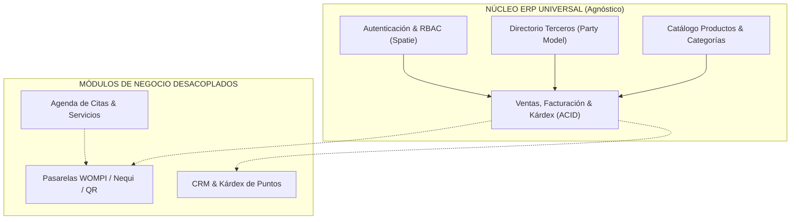
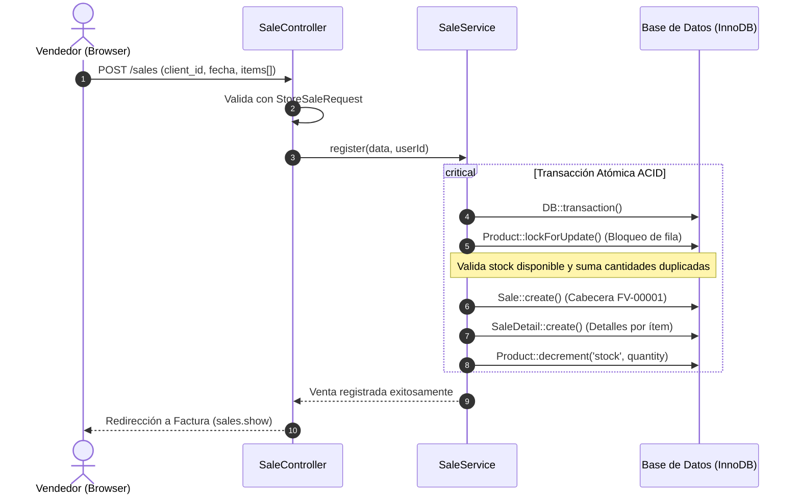

# Sistema de Gestión Empresarial (ERP) — Nexus ERP
## Plataforma Modular Multi-Empresa con Vertical de Comercio y Servicios (Barbería & Perfumería JyM)
### Informe Técnico de Arquitectura y Manual Operativo — Segundo Corte (Clases 6, 7, 8 y 9)

> **Institución:** Corporación de Estudios Tecnológicos del Norte del Valle — **COTECNOVA**  
> **Sede:** Cartago, Valle del Cauca  
> **Facultad:** Ingeniería y Ciencias Aplicadas  
> **Programa Académico:** Tecnología en Gestión de Sistemas de Información — Semestre VI  
> **Asignatura:** Software de Gestión Empresarial (SGE - 2026)  
> **Docente Titular:** Ing. Jhon James Cano Sánchez  
> **Autores / Desarrolladores:**  
> • **Brandon Cortés Giraldo**  
> • **Johan Sttive Linares Barragán**  
> **Instancia de Validación / Dominio:** Barbería y Perfumería JyM (Cartago) / Distribuidora Cosméticos del Eje  
> **Stack Tecnológico:** Laravel 11 / PHP 8.2+ / MariaDB / Tailwind CSS (Midnight Dark Enterprise) / Spatie Permission  

---

## 📑 Tabla de Contenidos
1. [Visión General y Enfoque Arquitectónico](#1-visión-general-y-enfoque-arquitectónico)
2. [Matriz Integral de Módulos del ERP](#2-matriz-integral-de-módulos-del-erp)
3. [Seguridad y Control de Acceso por Roles (RBAC Spatie - Clase 8)](#3-seguridad-y-control-de-acceso-por-roles-rbac-spatie---clase-8)
4. [Módulo Transaccional de Ventas e Inventario (Clase 9)](#4-módulo-transaccional-de-ventas-e-inventario-clase-9)
5. [Directorio de Clientes y Patrón Party Model](#5-directorio-de-clientes-y-patrón-party-model)
6. [Pasarelas de Pago Electrónicas (WOMPI & Nequi) y Webhooks](#6-pasarelas-de-pago-electrónicas-wompi--nequi-y-webhooks)
7. [CRM & Kárdex Contable de Fidelización](#7-crm--kárdex-contable-de-fidelización)
8. [Dashboard Ejecutivo con KPIs y Top 5 en Vivo](#8-dashboard-ejecutivo-con-kpis-y-top-5-en-vivo)
9. [Diseño Visual Enterprise (Midnight Dark Mode)](#9-diseño-visual-enterprise-midnight-dark-mode)
10. [Credenciales de Acceso y Datos de Prueba](#10-credenciales-de-acceso-y-datos-de-prueba)
11. [Guía de Instalación y Puesta en Marcha](#11-guía-de-instalación-y-puesta-en-marcha)
12. [Validación y Pruebas Automatizadas (PHPUnit)](#12-validación-y-pruebas-automatizadas-phpunit)

---

## 1. Visión General y Enfoque Arquitectónico

### 1.1. De Software Mononegocio a Plataforma ERP Real
Un error conceptual recurrente en el desarrollo de software es diseñar bases de datos acopladas a un solo tipo de negocio (tablas como `cortes_cabello` o `clientes_peluqueria`). Este proyecto fue concebido bajo los estándares de plataformas líderes como **SAP Business One** y **Odoo**:
1. **Núcleo Transaccional Universal:** Las entidades primarias (Productos, Terceros, Ventas, Facturación, Inventario e Impuestos) son 100% agnósticas al rubro comercial. El sistema tiene la misma capacidad técnica para vender una cera fijadora, un perfume de lujo, una libra de café o una caja de tornillos.
2. **Bajo Acoplamiento y Desconexión Modular (*Low Coupling*):** Los módulos satélites (Turnos/Citas de barbería, Pasarelas electrónicas, CRM de puntos) cuentan con claves foráneas opcionales (`nullable` con `onDelete('set null')`). Si una empresa no requiere servicios presenciales, el módulo de turnos se apaga por permisos y el ERP sigue operando como un sistema comercial puro.
3. **Arquitectura Multi-Empresa (`empresas` y `sucursales`):** La base de datos soporta múltiples compañías en paralelo. En el seeder conviven la **Barbería y Perfumería JyM** (servicios y mostrador) y la **Distribuidora Cosméticos del Eje** (bodega mayorista B2B).



---

## 2. Matriz Integral de Módulos del ERP

| Módulo | Ruta Base | Controlador Principal | Propósito Operativo |
| :--- | :--- | :--- | :--- |
| **Dashboard** | `/dashboard` | `DashboardController` | Indicadores clave (KPIs), métricas del mes y Top 5 productos más vendidos. |
| **Ventas (Clase 9)** | `/sales` | `SaleController` | Registro de facturas, cálculo dinámico de IVA (19%) y descuento de stock. |
| **Clientes (Clase 9)** | `/clients` | `ClientController` | Maestro de clientes comerciales con SoftDeletes y protección de integridad. |
| **Productos** | `/products` | `ProductController` | Catálogo de existencias, precios, categorías y papelera de reciclaje. |
| **Categorías** | `/categories` | `CategoryController` | Familias de artículos con conteo de productos asociados. |
| **Turnos (Citas)** | `/citas` | `CitaController` | Gestión de servicios de salón, profesionales y liquidación de comisiones. |
| **Terceros** | `/terceros` | `TerceroController` | Directorio Party Model (Clientes, Proveedores, Empleados) y Perfil 360°. |
| **Pasarelas de Pago** | `/pagos` | `PasarelaPagoController` | Conciliación de recaudos WOMPI/Nequi, simulación de webhooks y visor JSON. |
| **CRM & Puntos** | `/crm` | `CrmController` | Bitácora de contacto omnicanal y ledger inmutable de fidelización. |

---

## 3. Seguridad y Control de Acceso por Roles (RBAC Spatie - Clase 8)

El sistema implementa el paquete oficial de la industria **`spatie/laravel-permission`**, asegurando un control de acceso granular por rol y permiso tanto a nivel de controladores como en las vistas Blade.

### 3.1. Matriz de Roles y Permisos (`RolePermissionSeeder.php`)

| Permiso de Spatie | Rol `admin` | Rol `vendedor` | Rol `almacenista` |
| :--- | :---: | :---: | :---: |
| `ver-productos` | ✅ | ✅ | ✅ |
| `crear-productos` | ✅ | ❌ | ✅ |
| `editar-productos` | ✅ | ❌ | ✅ |
| `eliminar-productos` | ✅ | ❌ | ❌ |
| `ver-categorias` | ✅ | ❌ | ✅ |
| `crear-categorias` | ✅ | ❌ | ❌ |
| `ver-clientes` | ✅ | ✅ | ❌ |
| `crear-clientes` | ✅ | ✅ | ❌ |
| `editar-clientes` | ✅ | ✅ | ❌ |
| `eliminar-clientes` | ✅ | ❌ | ❌ |
| `ver-ventas` | ✅ | ✅ | ❌ |
| `crear-ventas` | ✅ | ✅ | ❌ |
| `eliminar-ventas` | ✅ | ❌ | ❌ |
| `ver-reportes` | ✅ | ❌ | ❌ |

### 3.2. Blindaje en Controladores (`HasMiddleware`)
En lugar de depender únicamente de rutas, los controladores validan internamente los permisos mediante middleware nativo de Laravel 11:
```php
public static function middleware(): array
{
    return [
        new Middleware('permission:ver-ventas', only: ['index', 'show']),
        new Middleware('permission:crear-ventas', only: ['create', 'store']),
        new Middleware('permission:eliminar-ventas', only: ['destroy']),
    ];
}
```
*Si un usuario no autorizado intenta forzar una URL por el navegador, Laravel responde inmediatamente con **HTTP 403 Forbidden**.*

---

## 4. Módulo Transaccional de Ventas e Inventario (Clase 9)

El módulo de ventas representa la materialización de la **integración modular del ERP**, cumpliendo con todas las exigencias de la **Guía de la Clase 9**.

### 4.1. Arquitectura de Servicio (`SaleService.php`)
Siguiendo las mejores prácticas de arquitectura limpia, la lógica transaccional fue extraída del controlador y encapsulada en `app/Services/SaleService.php`.



### 4.2. Reglas de Negocio Implementadas
1. **Control de Concurrencia:** `Product::lockForUpdate()` bloquea la fila del producto durante la transacción, impidiendo que dos vendedores simultáneos vendan el mismo stock físico.
2. **Cálculo Tributario de Ley (IVA 19% en Colombia):**
   $$\text{Subtotal} = \sum (\text{cantidad} \times \text{precio\_unitario})$$
   $$\text{IVA (19\%)} = \text{Subtotal} \times 0.19$$
   $$\text{Total Factura} = \text{Subtotal} + \text{IVA}$$
3. **Formulario Reactivo en JavaScript (`sales/create.blade.php`):**
   * Agrega y elimina filas de productos dinámicamente.
   * Calcula Subtotal, IVA 19% y Total en tiempo real mientras el usuario digita cantidades.
   * Si el servidor rechaza la venta (por ejemplo, por stock insuficiente), el formulario **reconstruye automáticamente las filas anteriores** mediante `old('items')` sin perder la información digitada.
4. **Regla de Negocio Inversa (Anulación de Factura):**
   * Al anular una factura (`DELETE /sales/{id}`), el sistema ejecuta una transacción que actualiza el estado a `anulada`, aplica `softDeletes` y **devuelve automáticamente las unidades al stock** de cada producto mediante `increment('stock', $detail->quantity)`.

---

## 5. Directorio de Clientes y Patrón Party Model

### 5.1. Módulo Estándar de Clientes (`clients`)
* Implementa CRUD completo con Form Requests (`StoreClientRequest`, `UpdateClientRequest`).
* Tipos de documento oficiales: `CC` (Cédula de Ciudadanía), `NIT`, `CE` (Cédula de Extranjería), `PP` (Pasaporte).
* **Integridad Referencial:** Regla de negocio que prohíbe eliminar un cliente si ya tiene facturas de venta asociadas (`$client->sales()->exists()`).
* **SoftDeletes y Papelera:** Papelera de reciclaje independiente con capacidad de restauración de registros.

### 5.2. Patrón Party Model en Terceros (`terceros`)
Para la gestión omnicanal de la empresa matriz, el ERP integra el patrón **Party Model** de Martin Fowler:
* Un mismo tercero (ej. *Carlos Alberto Duque*) puede actuar simultáneamente como **Empleado Especialista** (con 50% de comisión en servicios) y como **Cliente** de mostrador (acumulando puntos de fidelidad).

---

## 6. Pasarelas de Pago Electrónicas (WOMPI & Nequi) y Webhooks

El módulo de pasarelas centraliza la trazabilidad de recaudos electrónicos vinculados a citas o ventas de mostrador:
* **WOMPI (Bancolombia, PSE, Tarjetas):** Generación de checkout y simulación de pagos con datos comerciales de la empresa matriz.
* **NEQUI (QR Dinámico & Push):** Generación de código QR interactivo con teléfono del cliente para cobro móvil directo.
* **Simulador de Webhooks y Payload Crudo:** En la vista de checkout ([`/pagos/checkout/{id}`](http://127.0.0.1:8000/pagos)) se puede simular la confirmación bancaria (`APPROVED` o `DECLINED`). El sistema procesa el evento y renderiza el **JSON crudo** almacenado en la base de datos para auditoría financiera.

---

## 7. CRM & Kárdex Contable de Fidelización

* **Ledger Inmutable de Puntos:** Cada punto otorgado o redimido se asienta en un kárdex con saldo anterior, saldo nuevo, fecha y motivo de la transacción.
* **Bitácora Omnicanal 360°:** Registro en tiempo real de interacciones con clientes clasificadas por canal (`WhatsApp`, `Llamada`, `Presencial`, `Email`) y tipo (`Preferencia`, `Seguimiento`, `Felicitación`, `Reclamo PQR`).
* **Ranking VIP:** Listado dinámico de los clientes con mayor frecuencia y acumulación de puntos.

---

## 8. Dashboard Ejecutivo con KPIs y Top 5 en Vivo

El panel principal ([`/dashboard`](http://127.0.0.1:8000/dashboard)) consolida la toma de decisiones en tiempo real mediante tarjetas sin bordes de alto contraste:
1. **Productos Activos:** Total de referencias comerciales disponibles.
2. **Stock Bajo ($\le 5$ unidades):** Alerta preventiva para reabastecimiento de bodega.
3. **Valor del Inventario:** Valuación monetaria total: $\sum (\text{precio} \times \text{stock})$.
4. **Clientes Activos:** Total de cuentas de clientes registradas en el sistema.
5. **Ventas del Mes:** Conteo de facturas emitidas y monto total recaudado en COP.
6. **🔥 Top 5 Productos Más Vendidos Este Mes:** Tabla analítica que agrupa `SaleDetail` por producto y ordena descendentemente por unidades despachadas.

---

## 9. Diseño Visual Enterprise (Midnight Dark Mode)

La interfaz gráfica fue rediseñada para ofrecer una experiencia ejecutiva de alta gama:
* **Fondo Principal:** Obsidian Slate (`#090D16`) de bajo impacto visual.
* **Tarjetas y Contenedores:** `bg-slate-900/80` con desenfoque de fondo (*backdrop blur*) y bordes de acento sutiles (`border-slate-800/80`).
* **Tarjetas KPI Flotantes:** Sin bordes rígidos, con sombras suaves de elevación e íconos en acentos cromáticos.
* **Tipografía y Alto Contraste:** Textos en blanco nítido (`text-white`) y slate claro (`text-slate-300`) garantizando legibilidad perfecta.
* **Cero Tonos Naranjas:** Paleta basada en azul real, índigo eléctrico, esmeralda y cian.
* **Protección de Autofill:** Reglas de CSS para neutralizar el fondo blanco por defecto que inyectan los navegadores en inputs de autenticación.

---

## 10. Credenciales de Acceso y Datos de Prueba

Todos los usuarios de prueba están precargados en la base de datos con la contraseña estándar: **`password`**

| Usuario / Correo | Rol Asignado | Alcance en el ERP |
| :--- | :--- | :--- |
| **`admin@test.com`** | **Admin** | Control total del sistema: Ventas, Clientes, Inventario, Categorías, Papelera y Reportes. |
| **`vendedor@test.com`** | **Vendedor** | Puede consultar catálogo, registrar clientes y emitir ventas. Bloqueado para eliminar o editar stock. |
| **`almacenista@test.com`** | **Almacenista** | Administra catálogo, crea productos y categorías. Bloqueado para ventas y clientes. |

---

## 11. Guía de Instalación y Puesta en Marcha

### Requisitos Previos
* PHP 8.2 o superior con extensiones `pdo_mysql`, `mbstring`, `openssl`.
* Composer 2.x
* MariaDB / MySQL 8.x
* WSL2 (Ubuntu) en entornos Windows.

### Pasos de Instalación
```bash
# 1. Clonar el repositorio
git clone https://github.com/Brandon07-code/SoftwareGestionEmpresarial.git
cd SoftwareGestionEmpresarial/src

# 2. Instalar dependencias de PHP
composer install

# 3. Configurar entorno
cp .env.example .env
php artisan key:generate

# 4. Ejecutar migraciones con Seeders completos
php artisan migrate:fresh --seed

# 5. Iniciar servidor de desarrollo
php artisan serve
```
La aplicación estará disponible inmediatamente en: **`http://127.0.0.1:8000`**

---

## 12. Validación y Pruebas Automatizadas (PHPUnit)

El ERP cuenta con una suite de pruebas automatizadas que certifican la integridad del código, la seguridad de rutas y el cumplimiento de las reglas de negocio de la Clase 9.

### Ejecución de Pruebas
```bash
php artisan test
```

### Resultados de la Suite
```
   PASS  Tests\Unit\ExampleTest
  ✓ that true is true

   PASS  Tests\Feature\Auth\AuthenticationTest
  ✓ login screen can be rendered
  ✓ users can authenticate using the login screen
  ✓ users can not authenticate with invalid password
  ✓ users can logout

   PASS  Tests\Feature\ErpViewsTest
  ✓ authenticated user can view all erp modules (/dashboard, /products, /categories, /citas, /terceros, /pagos, /crm, /clients, /sales)

   PASS  Tests\Feature\RolePermissionTest
  ✓ admin has full access
  ✓ vendedor can view products but cannot create (403 Forbidden)
  ✓ almacenista can create products but cannot delete (403 Forbidden)

   PASS  Tests\Feature\SaleIntegrationTest (Clase 9)
  ✓ can register sale and stock is decremented
  ✓ cannot sell more than available stock (ValidationException)
  ✓ canceling sale restores stock (Atomic Rollback)
  ✓ cannot delete client with sales (Integrity Constraint)

Tests: 33 passed (98 assertions)
Duration: 4.85s
Status: 100% VERDE
```

---

<p align="center">
  <strong>Brandon Cortés Giraldo</strong> · Estudiante COTECNOVA<br>
  <strong>Johan Sttive Linares Barragán</strong> · Estudiante COTECNOVA<br>
  <em>Cartago, Valle del Cauca — Octubre de 2026</em>
</p>
