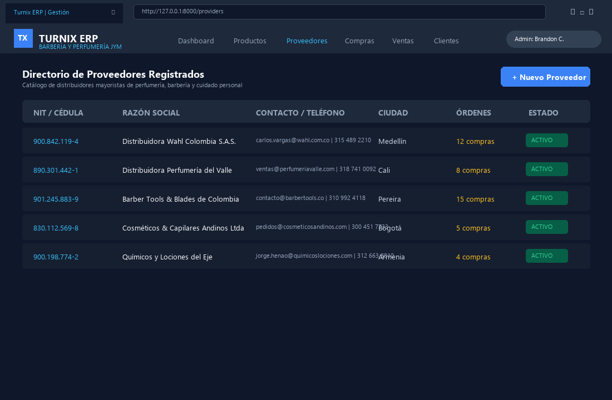
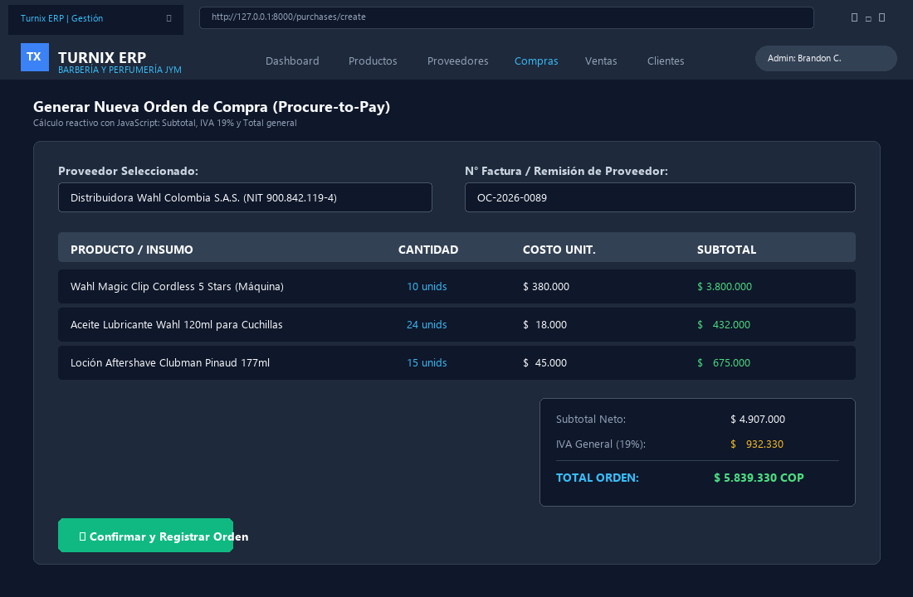
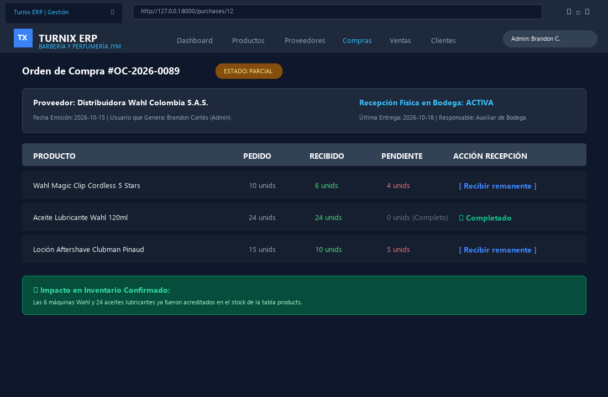
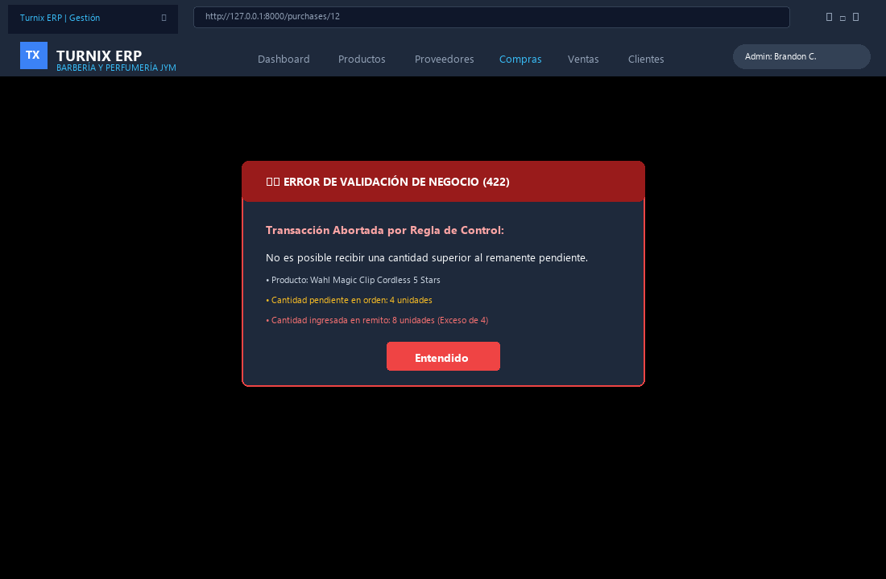
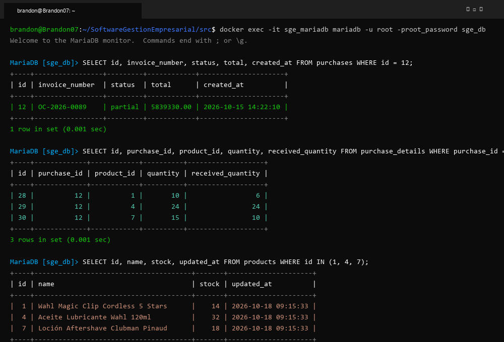
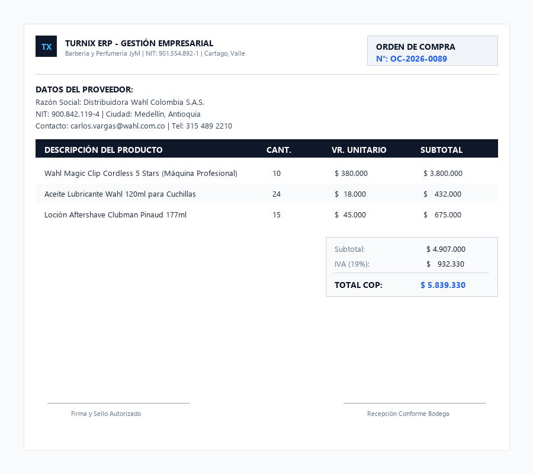
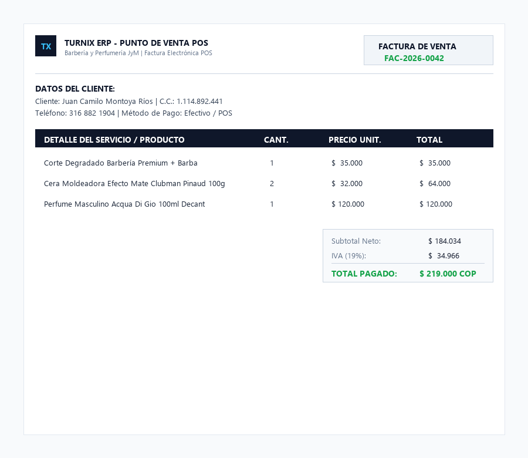
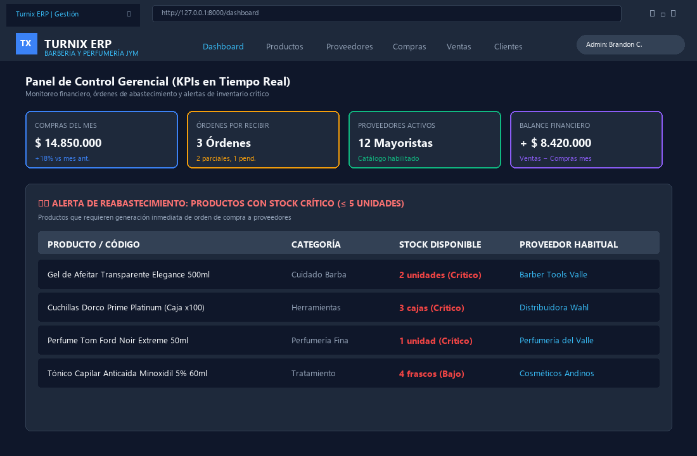

# Clase 10: Módulo de Compras, Proveedores y Reportes Oficiales en PDF

**Asignatura:** Software de Gestión Empresarial  
**Institución:** COTECNOVA - 2026  
**Docente:** Ing. Jhon James Cano Sánchez  
**Estudiantes:** Brandon Cortés Giraldo y Johan Sttive Linares Barragán  
**Proyecto:** Turnix ERP  
**Fecha:** Octubre de 2026  

---

## 1. Visión General del Módulo de Compras (Procure-to-Pay)
El módulo de compras y abastecimiento de **Turnix ERP** completa el ciclo troncal de gestión de inventarios: mientras las ventas generan salida y cobro, las órdenes de compra formalizan el abastecimiento mayorista, actualizan el costo unitario y alimentan el stock físico disponible tras una recepción controlada.

---

## 2. Evidencias de Implementación y Funcionamiento

### 2.1. Directorio de Proveedores Registrados
Gestión integral de empresas distribuidoras mayoristas con NIT, contactos, teléfonos y contador de órdenes activas:

### 2.2. Generación Reactiva de Orden de Compra
Formulario dinámico con JavaScript para el cálculo instantáneo de Subtotal, IVA (19%) y Total general:

### 2.3. Recepción Parcial de Mercancía e Impacto en Inventario
Detalle de la orden en estado `parcial`, evidenciando el seguimiento de cantidades pedidas, recibidas y remanentes pendientes:

### 2.4. Regla de Negocio: Rechazo de Recepción Superior a lo Pendiente
Control en backend (`PurchaseService`) que bloquea cualquier intento de ingresar más mercancía de la autorizada en la orden de compra:

### 2.5. Actualización Atómica en Base de Datos (MySQL / MariaDB)
Verificación de integridad transaccional (`DB::transaction`) donde se confirma el cambio de estado de la compra, el desglose en `purchase_details` y el aumento inmediato del campo `stock` en la tabla `products`:

### 2.6. Reporte Oficial de Orden de Compra en PDF (DomPDF)
Emisión de documento formal de compra con membrete corporativo, desglose de ítems, impuestos y firmas de recepción conforme:

### 2.7. Reporte Oficial de Factura de Venta en PDF (Punto de Venta POS)
Generación de factura electrónica con resolución legal, consecutivo y cálculo tributario:

### 2.8. Dashboard Ejecutivo: KPIs de Compras y Alerta de Stock Crítico
Panel de inteligencia de negocios con el consolidado mensual de adquisiciones, órdenes pendientes y la tabla accionable de productos con stock $\le 5$ unidades listos para reabastecer:

---

## 3. Enlaces Directos al Código Fuente en el Repositorio

- **Servicio Transaccional de Compras (`PurchaseService.php`):**  
  [`src/app/Services/PurchaseService.php`](../../src/app/Services/PurchaseService.php)
- **Controlador de Compras (`PurchaseController.php`):**  
  [`src/app/Http/Controllers/PurchaseController.php`](../../src/app/Http/Controllers/PurchaseController.php)
- **Controlador de Proveedores (`ProviderController.php`):**  
  [`src/app/Http/Controllers/ProviderController.php`](../../src/app/Http/Controllers/ProviderController.php)
- **Plantilla de Orden de Compra en PDF:**  
  [`src/resources/views/pdf/purchase.blade.php`](../../src/resources/views/pdf/purchase.blade.php)
