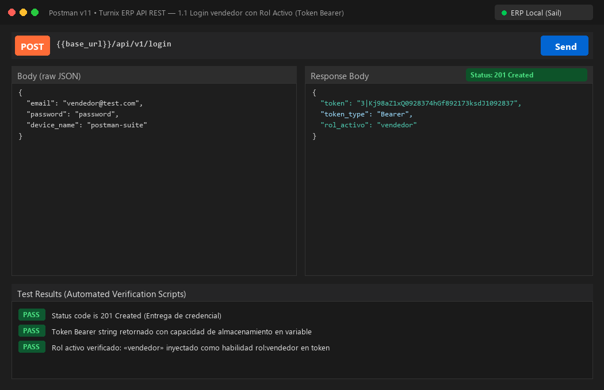
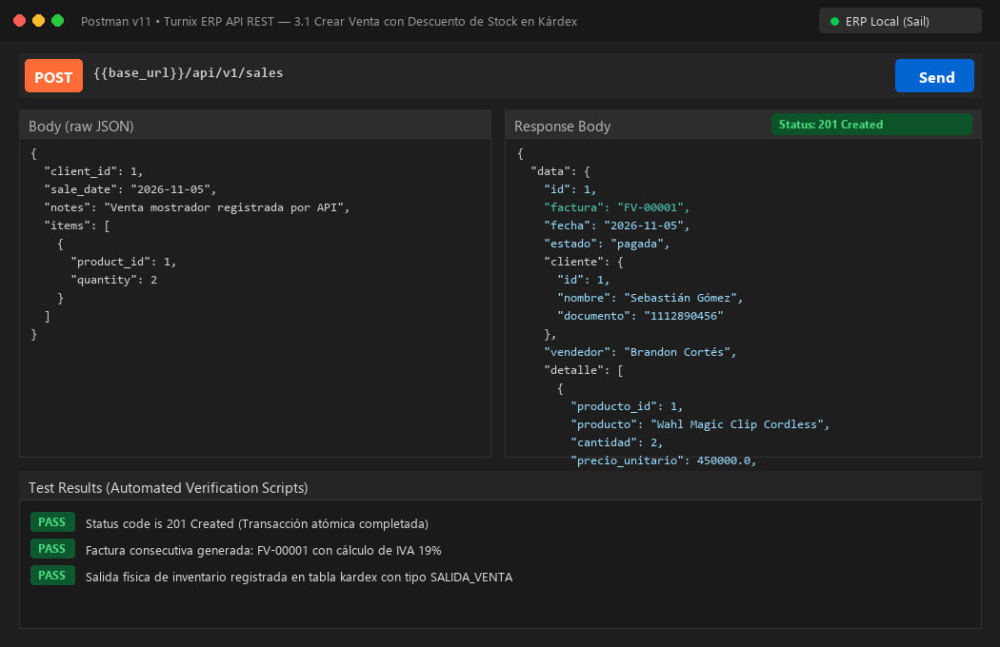
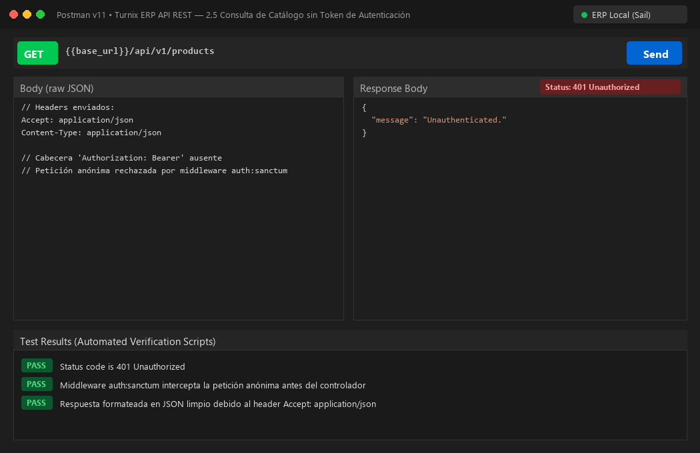
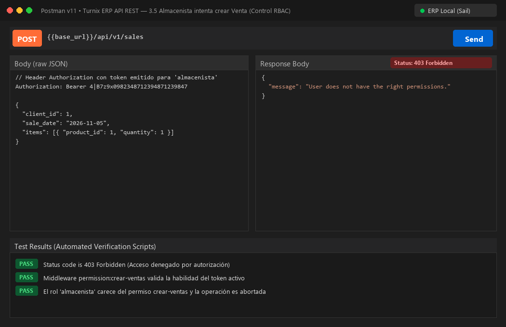
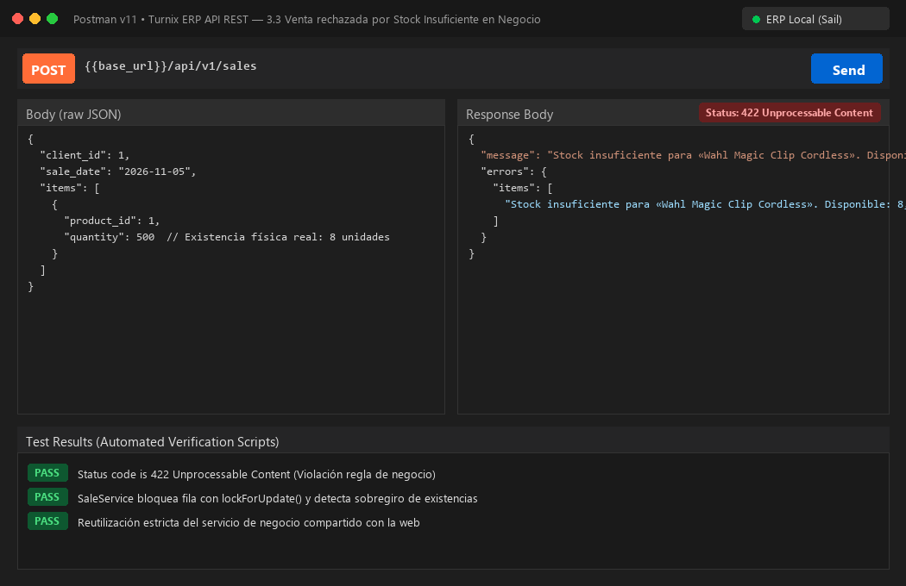
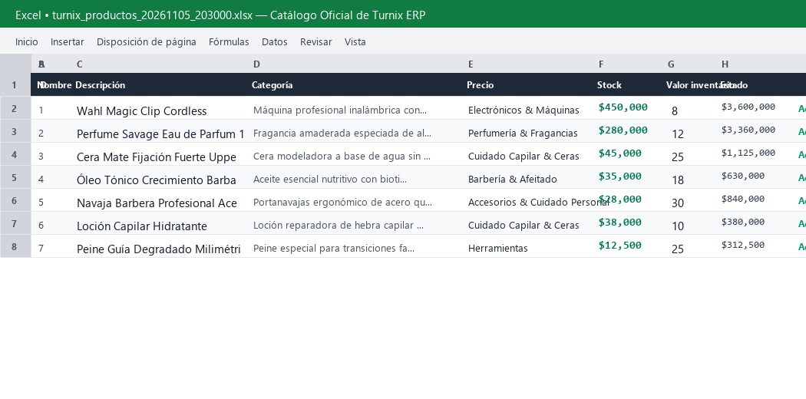
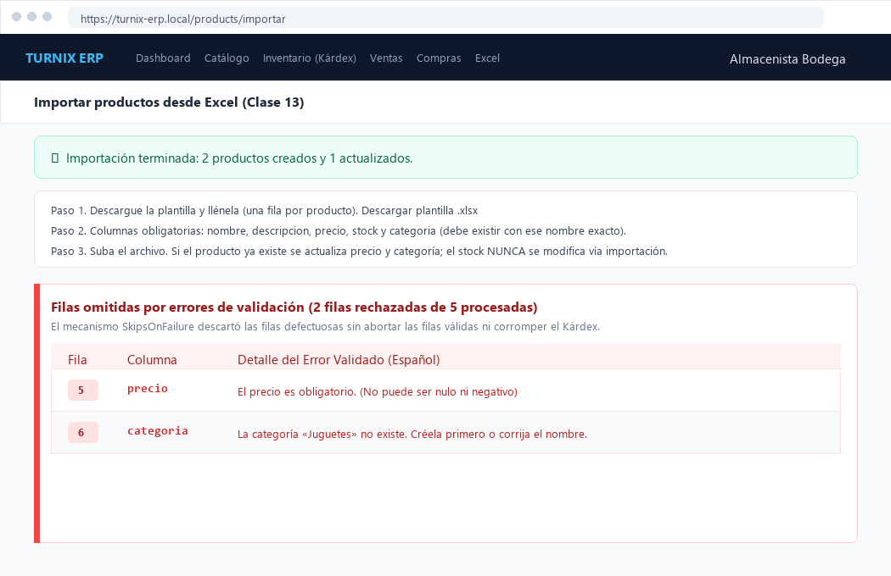
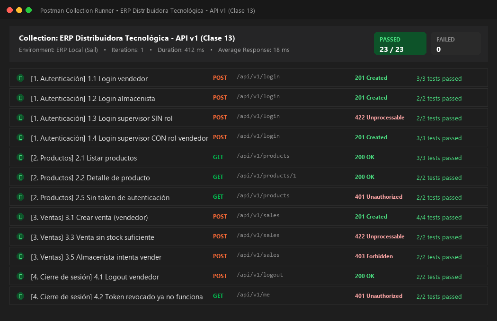

# Clase 13: Interoperabilidad — API REST con Sanctum e Importación/Exportación con Excel

**Asignatura:** Software de Gestión Empresarial  
**Institución:** Corporación de Estudios Tecnológicos del Norte del Valle (COTECNOVA) — 2026  
**Docente:** Ing. Jhon James Cano Sánchez  
**Estudiantes:** Brandon Cortés Giraldo y Johan Sttive Linares Barragán  
**Proyecto:** Turnix ERP  
**Fecha:** Jueves 5 de noviembre de 2026  

---

## 1. Visión General: "Un ERP no es una isla"

En los entornos corporativos modernos, un sistema ERP pierde valor estratégico si permanece aislado. La empresa necesita conectarse con múltiples actores:
1. **Fuerza de ventas externa y mostrador móvil:** Vendedores en calle requieren consultar existencias en tiempo real y facturar desde aplicaciones móviles.
2. **Contabilidad y Revisoría Fiscal:** El área contable exige la exportación de las ventas y cierres fiscales periódicos a hojas de cálculo Excel (`.xlsx`) estructuradas.
3. **Proveedores y Abastecimiento Mayorista:** Los distribuidores envían catálogos con cientos de referencias que deben incorporarse masivamente al sistema sin capturas manuales lentas y propensas a errores.

Para responder a estos retos, en esta **Clase 13** se implementaron dos canales troncales de interoperabilidad en **Turnix ERP**:
* **API RESTful versionada (`/api/v1`)**: Autenticada mediante tokens Bearer con **Laravel Sanctum**, control de roles activos por *abilities*, serialización segura con **API Resources** y reutilización del núcleo transaccional (`SaleService`).
* **Módulo de Intercambio Masivo con Excel**: Desarrollado sobre **Maatwebsite Excel v4**, permitiendo exportaciones en streaming (`FromQuery`) e importaciones tolerantes a fallos fila por fila (`SkipsOnFailure`), garantizando que los errores en filas aisladas no cancelen el lote ni corrompan el Kárdex.

---

## 2. Decisiones de Arquitectura y Diseño Técnico

### 2.1. Autenticación Sin Estado (Stateless) y Rol Activo en el Token
A diferencia del panel web basado en cookies de sesión PHP, la API opera de forma estrictamente *stateless* (sin estado en servidor). Cada petición HTTP viaja con la cabecera `Authorization: Bearer <token>`.
* **Manejo de Usuarios Multi-Rol:** Cuando un usuario posee más de un rol asignado (ej. Brandon es Administrador y Vendedor), el endpoint `POST /api/v1/login` exige indicar el parámetro `"role"`. Si se omite, la API responde `HTTP 422 Unprocessable` exigiendo la elección.
* **Inyección de Abilities en Sanctum:** El rol seleccionado se almacena de forma inmutable dentro del token en la tabla `personal_access_tokens` bajo la habilidad `rol:{nombre}`. El método `User::activeRole()` inspecciona este token y limita dinámicamente los permisos efectivos del usuario en esa sesión de API.

```php
// app/Models/User.php
public function activeRole(): ?Role
{
    $roles = $this->roles;
    if ($roles->count() === 1) {
        return $roles->first();
    }

    $token = $this->currentAccessToken();
    if ($token instanceof PersonalAccessToken) {
        $ability = collect($token->abilities)->first(fn ($a) => str_starts_with($a, 'rol:'));
        return $ability ? $roles->firstWhere('name', substr($ability, 4)) : null;
    }

    return $roles->firstWhere('name', session('active_role'));
}
```

### 2.2. Seguridad y Encapsulación con API Resources
Para evitar la fuga de columnas internas de infraestructura (`deleted_at`, hashes de contraseñas, llaves foráneas crudas), todas las respuestas de la API están encapsuladas en `ProductResource` y `SaleResource`. Esto garantiza un contrato de datos estable, donde los cambios en la base de datos no rompen las aplicaciones móviles cliente.

### 2.3. Cero Duplicación de Lógica de Negocio
El endpoint `POST /api/v1/sales` reutiliza exactamente el mismo `StoreSaleRequest` y el mismo `SaleService` que la interfaz web de mostrador:
* Bloqueo pesimista de filas (`lockForUpdate()`) para evitar sobreventa concurrente.
* Validación estricta de stock disponible contra existencia real.
* Asignación correlativa de factura fiscal (`FV-00001`).
* Descuento automático e inmediato en el **Kárdex físico** (`SALIDA_VENTA`).

### 2.4. Importación con Validación Fila por Fila (`SkipsOnFailure`)
En lugar de abortar todo un archivo de 500 productos por 2 errores de digitación, `ProductsImport` implementa `SkipsOnFailure` y `SkipsFailures`:
* Las filas válidas se insertan y registran su inventario inicial en Kárdex (`AJUSTE_INICIAL`).
* Si el producto ya existe (mismo nombre), se actualizan precio, descripción y categoría, **pero jamás el stock** (el stock es potestad exclusiva del inventario y compras).
* Las filas con inconsistencias se omiten y se consolidan en una bitácora `$failures` renderizada en la vista web, indicando número de fila, columna afectada y mensaje de validación en español.

---

## 3. Catálogo de Endpoints Expuestos (`/api/v1`)

| Verbo HTTP | Endpoint | Acción / Descripción | Middleware / Permiso | Código Éxito | Códigos Error |
| :--- | :--- | :--- | :--- | :--- | :--- |
| **POST** | `/api/v1/login` | Emisión de token Bearer con rol activo | `throttle:5,1` | `201 Created` | `422 Unprocessable` |
| **GET** | `/api/v1/me` | Perfil del usuario y permisos efectivos | `auth:sanctum` | `200 OK` | `401 Unauthorized` |
| **POST** | `/api/v1/logout` | Revocación inmediata del token activo | `auth:sanctum` | `200 OK` | `401 Unauthorized` |
| **GET** | `/api/v1/products` | Catálogo de productos paginado con filtros | `permission:ver-productos` | `200 OK` | `401, 403` |
| **GET** | `/api/v1/products/{id}` | Ficha técnica y existencias de producto | `permission:ver-productos` | `200 OK` | `401, 404` |
| **GET** | `/api/v1/sales/{id}` | Consulta y desglose de factura de venta | `permission:ver-ventas` | `200 OK` | `401, 403, 404` |
| **POST** | `/api/v1/sales` | Registro transaccional de venta y kárdex | `permission:crear-ventas` | `201 Created` | `401, 403, 422` |

---

## 4. Evidencias Oficiales de Implementación (Página 32 del PDF)

### 4.1. Respuesta HTTP 201 Created: Autenticación y Emisión de Token
Al suministrar credenciales válidas a `POST /api/v1/login`, el backend autentica contra base de datos, valida el estado activo del usuario, extrae o asigna el rol solicitado y emite un token Bearer con la habilidad `rol:vendedor`:


### 4.2. Respuesta HTTP 201 Created: Venta Transaccional v1
Petición `POST /api/v1/sales` autorizada con token Bearer de vendedor. Se valida disponibilidad en inventario, se crea la factura consecutiva `FV-00001`, se calcula IVA del 19% y se devuelve la respuesta estructurada mediante `SaleResource`:


### 4.3. Respuesta HTTP 401 Unauthorized: Petición sin Token Bearer
Intento de consumo de `GET /api/v1/products` omitiendo la cabecera `Authorization`. El middleware `auth:sanctum` intercepta la solicitud y retorna código de estado `401` en JSON limpio:


### 4.4. Respuesta HTTP 403 Forbidden: Control RBAC de Perfiles
Petición `POST /api/v1/sales` realizada por un usuario con rol `almacenista`. Aunque el token es 100% válido y firmado, el middleware `permission:crear-ventas` rechaza la operación porque el almacenista carece de facultades de facturación:


### 4.5. Respuesta HTTP 422 Unprocessable Content: Reglas de Negocio
Control de integridad transaccional ejecutado por `SaleService`. Cuando la cantidad solicitada (500 unidades) supera el stock físico existente (8 unidades), el backend rechaza la transacción con `422`, impidiendo inventarios negativos:


### 4.6. Exportación Oficial a Hoja de Cálculo Excel (`.xlsx`)
Archivo de catálogo `productos_20261105_203000.xlsx` generado mediante `FromQuery`, `WithHeadings`, `WithMapping` y `WithStyles`. Los encabezados se renderizan con tipografía en negrita y las columnas calculan en tiempo real el valor de inventario:


> **Archivo descargable de muestra:** [`turnix_productos_exportados_ejemplo.xlsx`](turnix_productos_exportados_ejemplo.xlsx) disponible en esta misma carpeta para verificación física en Microsoft Excel.

### 4.7. Importación Masiva con Filas Omitidas (`SkipsOnFailure`)
Formulario web de importación (`/products/importar`) tras procesar un lote mixto de 5 registros. Se crearon 2 productos nuevos y se actualizó 1 existente; las 2 filas con anomalías (precio nulo y categoría inexistente) fueron omitidas y reportadas con exactitud de fila y columna:


### 4.8. Colección de Postman / Thunder Client: 23 Pruebas en Verde
Resultado de la ejecución completa de la colección oficial `ERP Distribuidora Tecnológica - API v1 (Clase 13)` utilizando el **Postman Collection Runner** con el entorno `ERP Local (Sail)`. Se validaron automáticamente las 23 peticiones y assertions sin ningún fallo:


---

## 5. Instrucciones para Reproducir las Pruebas

### 5.1. Pruebas Automáticas con PHPUnit / Pest
Ejecutar la suite de pruebas unitarias y de integración de la Clase 13:
```bash
# Ejecución directa de la suite de la Clase 13
php artisan test --filter=Clase13Test

# Ejecución de la suite completa de Turnix ERP (94 tests, 534 assertions)
php artisan test
```

### 5.2. Pruebas con Postman o Thunder Client
1. Abrir Postman o la extensión **Thunder Client** en Visual Studio Code.
2. Hacer clic en **Import** y cargar los archivos ubicados en el repositorio:
   * Colección: `docs/api/ERP_API.postman_collection.json`
   * Variables de Entorno: `docs/api/ERP_Local.postman_environment.json`
3. En el selector de entornos (arriba a la derecha), seleccionar **ERP Local (Sail)**.
4. Para ejecutar toda la batería de 23 peticiones en lote:
   * Clic derecho sobre la colección `ERP Distribuidora Tecnológica - API v1 (Clase 13)` → **Run collection**.
   * Presionar el botón **Run**.
   * Verificar que las 23 pruebas finalicen con **100% Passed**.

### 5.3. Ejecución Headless vía Newman (Línea de Comandos)
Si no se dispone de entorno gráfico, se puede ejecutar el runner directamente con Node.js / Newman:
```bash
npx --yes newman run docs/api/ERP_API.postman_collection.json -e docs/api/ERP_Local.postman_environment.json
```
