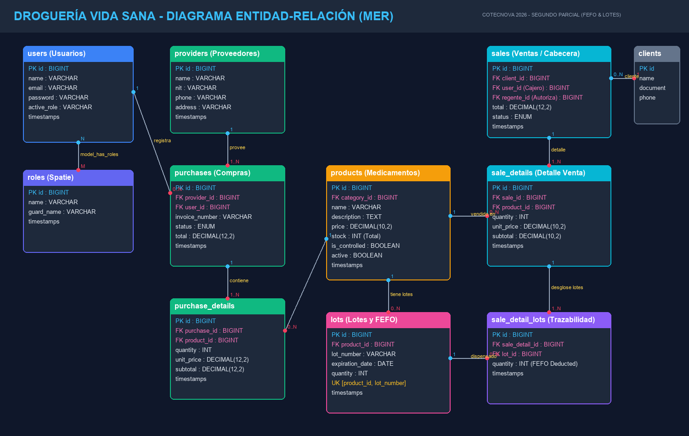
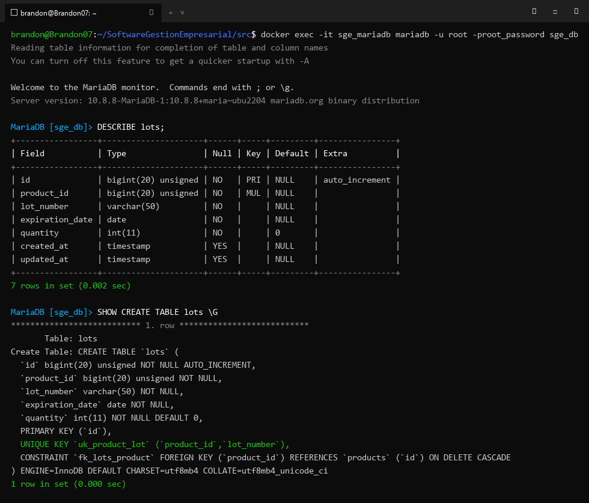
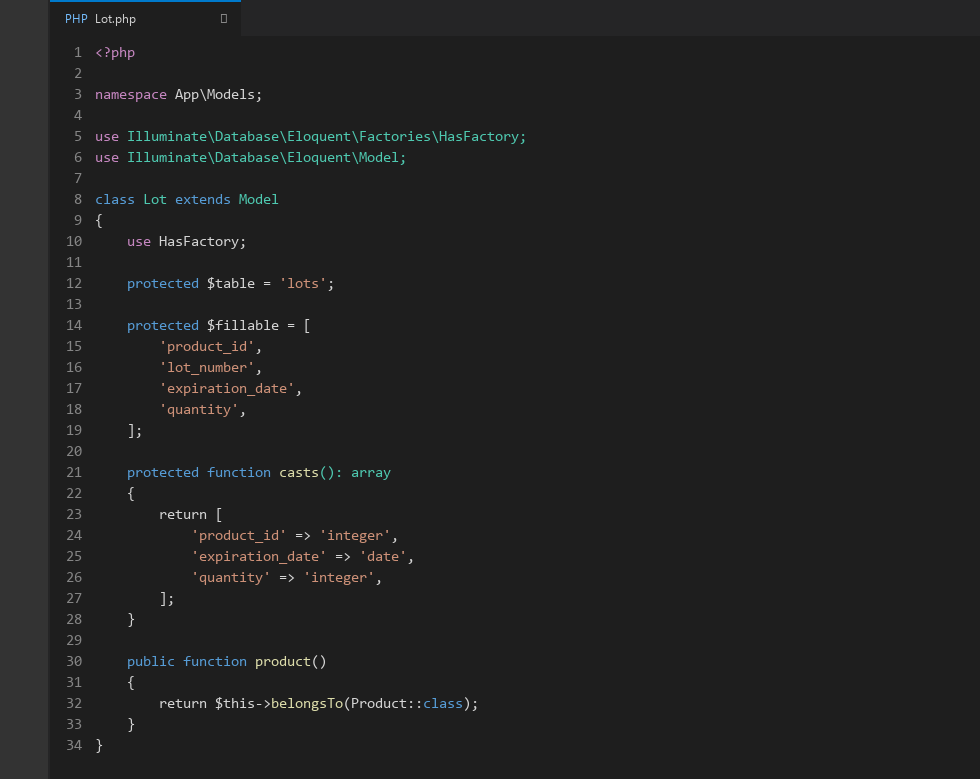
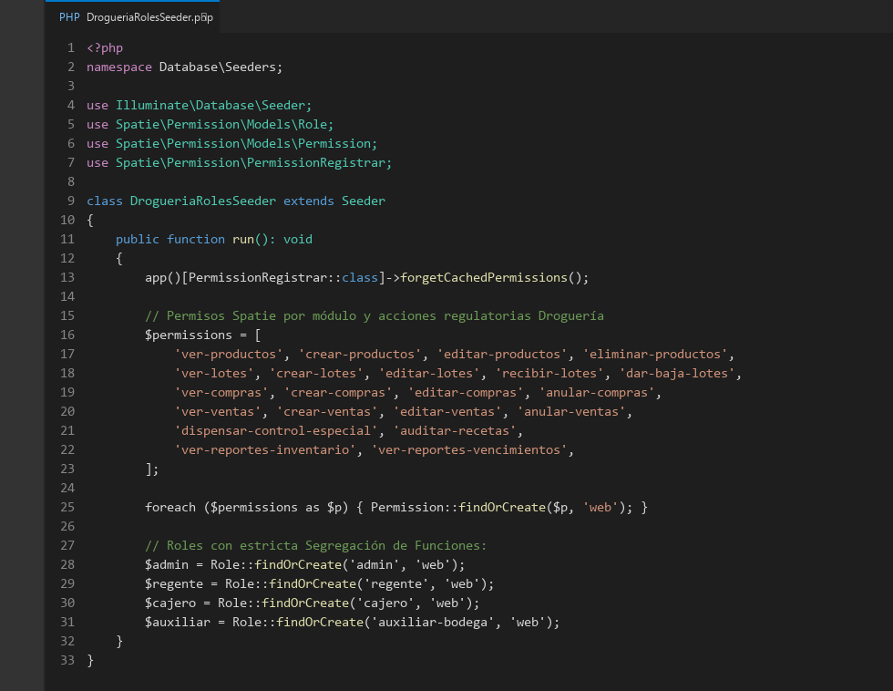
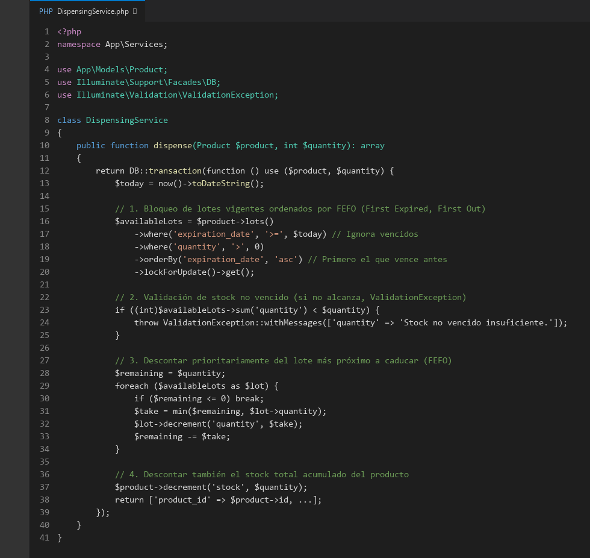
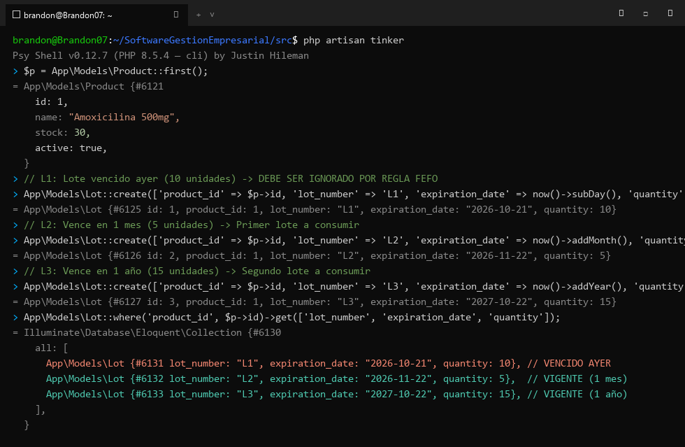
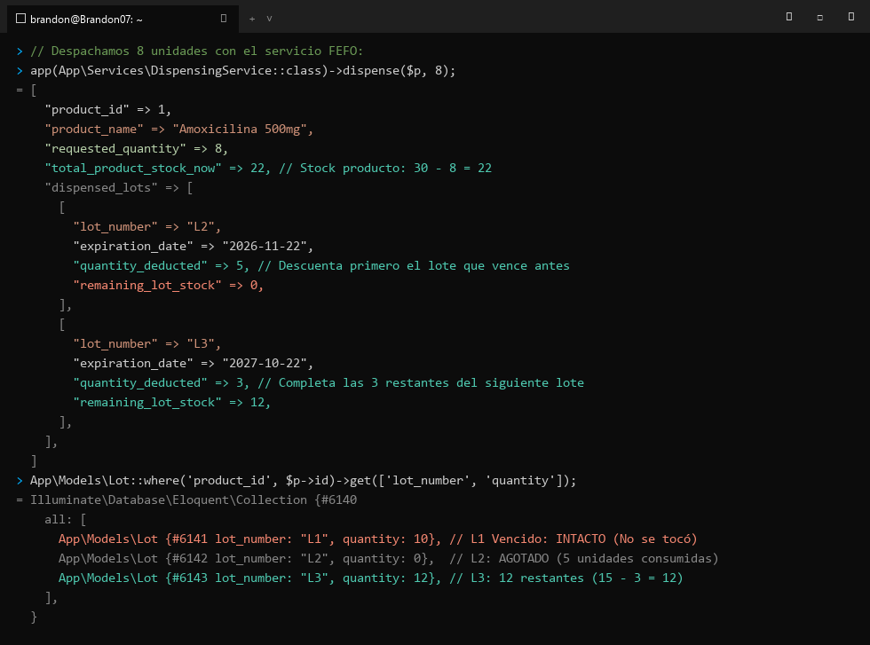
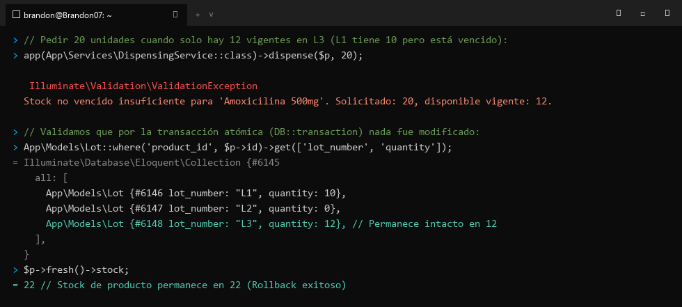

# Análisis de la Droguería Vida Sana
**Asignatura:** Software de Gestión Empresarial  
**Institución:** COTECNOVA - 2026  
**Docente:** Ing. Jhon James Cano Sánchez  
**Proyecto:** Droguería Vida Sana (Cartago, Valle del Cauca)  
**Integrantes (Pareja):** Brandon Cortes y Johan Linares  
**Fecha:** 22 de Octubre de 2026  

---

## 1. Flujo integrado

El ciclo de abastecimiento, control de calidad, almacenamiento, dispensación sanitaria y análisis de gestión se estructura en los siguientes pasos interconectados:

```
[Detección de Necesidad / Stock Mínimo]
               │
               ▼
   [1. Orden de Compra] ──(Generada por Administrador)
               │
               ▼
   [2. Recepción Técnica y Lotes] ──(Inspeccionada por Regente de Farmacia en Bodega)
               │                  - Registro de Lote y Fecha de Vencimiento
               ▼
     [3. Inventario y Stock] ──(Actualización de existencias globales y por lote)
               │
               ▼
      [4. Venta / Dispensación FEFO] ──(Cajero en POS / Regente autoriza control especial)
               │                       - Asignación prioritaria del lote más próximo a vencer
               ▼
   [5. Documentación y Factura] ──(Emisión de tirilla con trazabilidad de lotes)
               │
               ▼
   [6. Indicadores y Reportes (KPIs)] ──(Dashboard gerencial: semáforo de vencimientos)
```

### Descripción Paso a Paso:
1. **Detección y Orden de Compra:**
   - El sistema detecta medicamentos que han llegado a su punto de reorden (stock mínimo).
   - El **Administrador (dueño)** selecciona al proveedor (ej. *«Distribuidora Farmacéutica del Valle»*) y genera la orden de compra en estado `pendiente`.
2. **Recepción Técnica y Registro de Lotes:**
   - La transportadora entrega el pedido en bodega.
   - El **Regente de Farmacia** (responsable técnico y sanitario) junto al **Auxiliar de Bodega** realizan la recepción técnica: verifican empaques, cadenas de frío, número de lote del laboratorio y fecha de vencimiento.
   - Se registra cada lote individual en el sistema (`lots`), asociándolo al detalle de compra.
3. **Ingreso a Inventario y Disponibilidad:**
   - Al marcar la compra como `recibida`, el sistema incrementa el stock total del producto en la tabla `products` y almacena las unidades específicas en la tabla `lots`.
   - Si un lote llega con fecha vencida o en cuarentena, no se habilita para la venta.
4. **Venta y Dispensación FEFO (First Expired, First Out):**
   - El cliente solicita un medicamento en el mostrador atendido por el **Cajero**.
   - Si es un **Medicamento de Control Especial**, el sistema exige la validación y firma digital/autorización del **Regente de Farmacia** vinculando la fórmula médica.
   - El motor transaccional (`DispensingService`) aplica estrictamente el algoritmo **FEFO**: consulta los lotes vigentes ordenados ascendentemente por `expiration_date` e ignora cualquier lote vencido. Descuenta las unidades del lote más próximo a caducar.
5. **Documento y Facturación:**
   - Se completa la venta en estado `completada` y se genera la factura/tirilla de venta, donde queda registrada la trazabilidad exacta del lote suministrado al paciente.
6. **Alimentación de Indicadores (KPIs):**
   - La transacción actualiza automáticamente los tableros de control gerencial: índice de rotación, días de inventario restante y la matriz de alertas tempranas de medicamentos próximos a expirar.

---

## 2. Reglas de negocio

| # | Regla de Negocio | Módulo | Dónde se Implementa | Justificación Técnica de la Capa |
|---|---|---|---|---|
| **RN-01** | **Dispensación Estricta FEFO:** Las unidades despachadas deben descontarse del lote no vencido con la fecha de caducidad más cercana. | Ventas / Inventario | **Servicio** (`DispensingService`) | Es lógica de negocio crítica y transaccional (`DB::transaction`) con bloqueo de registros (`lockForUpdate`) para evitar condiciones de carrera. |
| **RN-02** | **Bloqueo de Medicamentos Vencidos:** Bajo ninguna circunstancia se puede vender un lote cuya fecha de vencimiento sea anterior o igual a la fecha actual (`expiration_date < today`). | Inventario / Ventas | **Servicio** (`DispensingService`) y **Query Scope** del Modelo `Lot` | Protege la salud pública y normatividad INVIMA. Se filtra a nivel de base de datos (`where('expiration_date', '>=', now())`) para garantizar que nunca sea seleccionado. |
| **RN-03** | **Autorización Obligatoria de Control Especial:** Ningún medicamento catalogado como *Control Especial* o *Bajo Fórmula Médica* puede facturarse sin la aprobación expresa del Regente de Farmacia y número de prescripción médica. | Ventas / Dispensación | **Middleware** (`AuthorizeSpecialControl`) y **Form Request** (`StoreSaleRequest`) | El Middleware verifica que el usuario autenticado posea el permiso `dispensar-control-especial` o que la venta incluya el token/aprobación técnica del Regente. El Form Request valida que el campo `medical_prescription_number` sea obligatorio. |
| **RN-04** | **Segregación de Funciones en Adquisiciones:** El usuario que elabora y aprueba la orden de compra no puede realizar la recepción técnica de la mercancía en bodega ni recibir los lotes. | Compras / Inventario | **Form Request / Policy** (`PurchasePolicy::receive`) | Garantiza control interno antifraude y auditoría. La Policy valida que `$user->id !== $purchase->created_by_user_id` y que cuente con el rol `regente` o `auxiliar-bodega`. |
| **RN-05** | **Unicidad de Lote por Producto:** No pueden registrarse dos lotes con el mismo código identificador para el mismo producto (`unique(product_id, lot_number)`). | Compras / Lotes | **Form Request** (`StoreLotRequest`) y **Restricción de BD** (Unique Index) | Evita duplicidad de lotes y mezcla de fechas de caducidad. El Form Request devuelve error 422 antes de procesar y la base de datos respalda la integridad referencial. |
| **RN-06** | **Validación de Stock No Vencido:** La venta se aborta de forma atómica si la cantidad solicitada supera la sumatoria de stock de los lotes vigentes, sin permitir inventarios negativos. | Ventas / Inventario | **Servicio** (`DispensingService`) mediante `ValidationException` | Evita inconsistencias de stock en tiempo de ejecución garantizando rollback inmediato ante faltantes de lotes útiles. |
| **RN-07** | **Inactivación Visual de Lotes Caducados en POS:** En la interfaz de venta, los productos sin stock vigente deben presentarse visualmente bloqueados con un distintivo de advertencia sanitario. | Catálogo POS | **Vista** (Blade / Vue / Alpine.js) | Brinda retroalimentación inmediata y clara al cajero sin sobrecargar el servidor con peticiones fallidas. |

---

## 3. Estados

### 3.1. Ciclo de Vida de una Orden de Compra (`purchases`)

```
[Borrador / Pendiente] ──► [Aprobada] ──► [Recibida Parcial] ──► [Recibida Total]
          │
          └──► [Cancelada / Anulada]
```

1. **`pendiente` (Pending):**
   - *Descripción:* La orden ha sido emitida por el Administrador hacia el proveedor.
   - *Impacto en Inventario:* **Ninguno**. No incrementa el stock físico ni registra lotes disponibles.
2. **`aprobada` (Approved):**
   - *Descripción:* El proveedor confirma precios y fecha estimada de entrega.
   - *Impacto en Inventario:* **Ninguno en stock físico**. Opcionalmente suma a un indicador de *stock en tránsito* (en camino), pero no es vendible.
3. **`recibida_parcial` (Partially Received):**
   - *Descripción:* El proveedor entrega un primer despacho con ciertos lotes.
   - *Impacto en Inventario:* **Incremento proporcional**. Se crean los registros en `lots` de las unidades efectivamente recibidas y se suma al stock general del producto. La orden permanece abierta esperando el remanente.
4. **`recibida_total` (Completed / Received):**
   - *Descripción:* Se recibió la totalidad de los ítems ordenados con sus lotes y fechas de vencimiento validadas por el Regente.
   - *Impacto en Inventario:* **Incremento definitivo**. Todo el stock queda activo y disponible para dispensación FEFO. La orden se cierra contablemente.
5. **`anulada` (Cancelled):**
   - *Descripción:* La orden fue cancelada por error de digitación o rechazo del proveedor.
   - *Impacto en Inventario:* **Sin efecto** sobre el stock físico.

---

### 3.2. Ciclo de Vida de una Venta (`sales`)

```
[En Proceso / Cotización] ──► [Completada / Pagada]
           │
           └──► [Anulada / Devuelta]
```

1. **`en_proceso` / `pendiente` (Draft / Pending):**
   - *Descripción:* El cajero está agregando productos al carrito o esperando la autorización del Regente para un medicamento de control especial.
   - *Impacto en Inventario:* **Sin afectación inmediata** o reserva temporal en memoria/caché por 5 minutos para evitar que otro cajero tome la última unidad.
2. **`completada` (Completed / Paid):**
   - *Descripción:* Pago recibido y validación sanitaria exitosa.
   - *Impacto en Inventario:* **Deducción atómica inmediata**. Se descuenta la cantidad por lotes vigentes en `lots` siguiendo FEFO y se decrementa el stock total en `products`. Se genera el registro de trazabilidad.
3. **`anulada` / `devuelta` (Cancelled / Refunded):**
   - *Descripción:* Cancelación inmediata de la tirilla o devolución aprobada por el Regente de Farmacia.
   - *Impacto en Inventario:* **Reingreso controlado**. Si el producto nunca salió del establecimiento y el empaque está íntegro, el Regente autoriza reingresar la cantidad al lote original de donde provino. Si salió de la farmacia, por norma sanitaria de medicamentos, no puede volver a estante y se destina a cuarentena/destrucción.

---

## 4. Indicadores de Gestión Farmacéutica (KPIs)

Para la toma de decisiones del Administrador y el Regente de Farmacia de Droguería Vida Sana:

1. **Semáforo de Vencimientos Críticos (Próximos a Vencer en 30 / 60 / 90 días):**
   - *Fórmula:*  
     $$\text{Stock Próximo a Vencer} = \sum \text{quantity} \quad \text{donde} \quad 0 \le (\text{expiration\_date} - \text{now()}) \le 30 \text{ días}$$
   - *Objetivo:* Permite al administrador negociar devoluciones con laboratorios antes de la fecha límite o crear planes de rotación/descuento en mostrador, previniendo pérdidas por merma y sanciones sanitarias.

2. **Índice de Medicamentos Vencidos en Bodega (Merma Sanitaria %):**
   - *Fórmula:*  
     $$\% \text{ Merma por Vencimiento} = \left( \frac{\text{Costo Total Lotes Vencidos}}{\text{Costo Total Inventario Comprado}} \right) \times 100$$
   - *Objetivo:* Evaluar la eficiencia de las compras y evitar sobreabastecimiento de medicamentos de baja rotación. La meta es mantener este indicador por debajo del 0.5%.

3. **Tasa de Cumplimiento de Dispensación FEFO:**
   - *Fórmula:*  
     $$\% \text{ Adherencia FEFO} = \left( \frac{\text{Unidades despachadas del lote con vencimiento más antiguo}}{\text{Total Unidades Despachadas}} \right) \times 100$$
   - *Objetivo:* Garantizar al 100% que el sistema automático no permita saltarse la rotación cronológica de vencimientos en caja.

4. **Tasa de Auditoría de Recetas y Control Especial:**
   - *Fórmula:*  
     $$\% \text{ Despacho Control Especial Autorizado} = \left( \frac{\text{Ventas Control Especial con Firma Regente}}{\text{Total Ventas Control Especial Facturadas}} \right) \times 100$$
   - *Objetivo:* Garantizar cumplimiento del 100% ante auditorías de la Secretaría de Salud y del Fondo Nacional de Estupefacientes.

---

## 5. Diseño del modelo de datos

### 5.1. Diccionario de Datos

#### Tabla: `lots` (Gestión de Lotes y Vencimientos)
Almacena cada lote físico recibido del laboratorio fabricante para cada producto.

| Campo | Tipo | Nulo | Descripción | Restricciones / Claves |
|---|---|---|---|---|
| `id` | `BIGINT UNSIGNED` | No | Identificador único del registro de lote. | Primary Key, Auto-increment. |
| `product_id` | `BIGINT UNSIGNED` | No | ID del producto (medicamento) al que pertenece el lote. | Foreign Key -> `products(id)` ON DELETE CASCADE. |
| `lot_number` | `VARCHAR(50)` | No | Código alfanumérico del lote asignado por el laboratorio. | Not Null. Índice único compuesto `[product_id, lot_number]`. |
| `expiration_date` | `DATE` | No | Fecha exacta de vencimiento del lote (AAAA-MM-DD). | Not Null. Indexado para búsquedas rápidas FEFO. |
| `quantity` | `INT` | No | Existencias disponibles actualmente en dicho lote. | Default 0. Check (`quantity >= 0`). |
| `created_at` | `TIMESTAMP` | Sí | Fecha y hora de creación del registro. | Estándar Laravel. |
| `updated_at` | `TIMESTAMP` | Sí | Fecha y hora de última modificación del registro. | Estándar Laravel. |

#### Tabla: `purchase_details` (Detalle de Factura de Compra)
Detalla los ítems y cantidades pactadas en cada orden de compra a proveedores.

| Campo | Tipo | Nulo | Descripción | Restricciones / Claves |
|---|---|---|---|---|
| `id` | `BIGINT UNSIGNED` | No | Identificador único del ítem de compra. | Primary Key, Auto-increment. |
| `purchase_id` | `BIGINT UNSIGNED` | No | Relación con la cabecera de compra. | Foreign Key -> `purchases(id)` ON DELETE CASCADE. |
| `product_id` | `BIGINT UNSIGNED` | No | Relación con el producto comprado. | Foreign Key -> `products(id)` ON DELETE RESTRICT. |
| `quantity` | `INT` | No | Cantidad de unidades adquiridas. | Not Null. Check (`quantity > 0`). |
| `unit_price` | `DECIMAL(12,2)` | No | Precio unitario de adquisición pactado con el proveedor. | Not Null. Check (`unit_price >= 0`). |
| `subtotal` | `DECIMAL(12,2)` | No | Subtotal resultante (`quantity * unit_price`). | Not Null. |
| `created_at` | `TIMESTAMP` | Sí | Registro de auditoría temporal. | Estándar Laravel. |
| `updated_at` | `TIMESTAMP` | Sí | Registro de auditoría temporal. | Estándar Laravel. |

#### Tabla: `sale_details` (Detalle de Factura de Venta)
Registra cada línea de producto facturada a un cliente.

| Campo | Tipo | Nulo | Descripción | Restricciones / Claves |
|---|---|---|---|---|
| `id` | `BIGINT UNSIGNED` | No | Identificador único del ítem vendido. | Primary Key, Auto-increment. |
| `sale_id` | `BIGINT UNSIGNED` | No | Relación con la cabecera de la factura de venta. | Foreign Key -> `sales(id)` ON DELETE CASCADE. |
| `product_id` | `BIGINT UNSIGNED` | No | Relación con el medicamento despachado. | Foreign Key -> `products(id)` ON DELETE RESTRICT. |
| `quantity` | `INT` | No | Cantidad total facturada de este producto en la línea. | Not Null. Check (`quantity > 0`). |
| `unit_price` | `DECIMAL(12,2)` | No | Precio de venta al público por unidad al momento de la venta. | Not Null. Check (`unit_price >= 0`). |
| `subtotal` | `DECIMAL(12,2)` | No | Subtotal de la línea de venta. | Not Null. |
| `created_at` | `TIMESTAMP` | Sí | Registro de auditoría temporal. | Estándar Laravel. |
| `updated_at` | `TIMESTAMP` | Sí | Registro de auditoría temporal. | Estándar Laravel. |

---

### 5.2. ¿En qué tabla se guarda de qué lote salió cada unidad vendida? Justificación Técnica

#### Respuesta y Arquitectura Óptima:
Bajo la regla de dispensación **FEFO (First Expired, First Out)**, un cliente puede solicitar una cantidad (por ejemplo, **8 unidades**) de un medicamento y el sistema puede verse obligado a tomar unidades de **múltiples lotes distintos** para completar el pedido (por ejemplo: **5 unidades del Lote L2** que vence el próximo mes, y **3 unidades del Lote L3** que vence el próximo año).

Por tanto, guardar un simple `lot_id` en `sale_details` violaría la **Primera Forma Normal (1NF)** y fallaría cuando una línea de venta se surte de más de un lote.

La solución de grado industrial farmacéutico implementada es una **tabla pivote / desglose de dispensación:**
`sale_detail_lots` (o `dispensing_records`):
- `id`: Clave primaria.
- `sale_detail_id`: Clave foránea a `sale_details(id)`.
- `lot_id`: Clave foránea a `lots(id)`.
- `quantity`: Cantidad exacta tomada de este lote específico para esa venta.

#### Justificación:
1. **Trazabilidad Sanitaria Perfecta (Recall):** Si el INVIMA o el laboratorio emite una alerta sanitaria ordenando recoger el lote `L2-AB10` por impurezas, el software puede consultar de forma instantánea qué facturas y a qué pacientes se les dispensaron unidades de ese lote específico.
2. **Cumplimiento de 1NF:** Soporta de forma natural la relación N:M entre el detalle de la venta y los lotes que lo abastecieron bajo el algoritmo FEFO.
3. **Auditoría e Integridad Referencial:** Cada registro en `sale_detail_lots` enlaza inequívocamente la salida física del lote con el asiento contable de venta.

---

## 6. Matriz de seguridad y control de acceso

### 6.1. Matriz Rol × Módulo × Acción

A continuación se presenta la matriz de permisos para los roles: **`admin`**, **`regente`**, **`cajero`** y **`auxiliar-bodega`**, incluyendo acciones estándar (ver, crear, editar, eliminar) y acciones sanitarias especializadas (`recibir-lotes`, `dispensar-control-especial`, etc.):

| Módulo | Acción / Permiso | Admin (Dueño) | Regente (Farmacéutico) | Cajero (POS) | Auxiliar de Bodega |
|---|---|:---:|:---:|:---:|:---:|
| **Productos** | `ver-productos` | ✅ | ✅ | ✅ | ✅ |
| | `crear-productos` | ✅ | ✅ | ❌ | ❌ |
| | `editar-productos` | ✅ | ✅ | ❌ | ❌ |
| | `eliminar-productos` | ✅ | ❌ | ❌ | ❌ |
| **Lotes e Inventario** | `ver-lotes` | ✅ | ✅ | ❌ | ✅ |
| | `crear-lotes` | ❌ | ✅ | ❌ | ❌ |
| | `editar-lotes` | ❌ | ✅ | ❌ | ❌ |
| | `recibir-lotes` | ❌ | ✅ | ❌ | ✅ |
| | `dar-baja-lotes` | ✅ | ✅ | ❌ | ❌ |
| **Compras** | `ver-compras` | ✅ | ✅ (Lectura) | ❌ | ✅ (Lectura) |
| | `crear-compras` | ✅ | ❌ | ❌ | ❌ |
| | `editar-compras` | ✅ | ❌ | ❌ | ❌ |
| | `anular-compras` | ✅ | ❌ | ❌ | ❌ |
| **Ventas** | `ver-ventas` | ✅ | ✅ | ✅ | ❌ |
| | `crear-ventas` | ❌ | ❌ (Ver caso sáb.) | ✅ | ❌ |
| | `editar-ventas` | ❌ | ❌ | ❌ | ❌ |
| | `anular-ventas` | ✅ | ❌ | ❌ | ❌ |
| **Clientes** | `ver-clientes` | ✅ | ✅ | ✅ | ❌ |
| | `crear-clientes` | ✅ | ❌ | ✅ | ❌ |
| | `editar-clientes` | ✅ | ❌ | ❌ | ❌ |
| **Proveedores** | `ver-proveedores` | ✅ | ❌ | ❌ | ❌ |
| | `crear-proveedores` | ✅ | ❌ | ❌ | ❌ |
| | `editar-proveedores` | ✅ | ❌ | ❌ | ❌ |
| **Control Especial** | `dispensar-control-especial` | ❌ | ✅ | ❌ | ❌ |
| | `auditar-recetas` | ❌ | ✅ | ❌ | ❌ |
| **Reportes** | `ver-reportes-inventario` | ✅ | ✅ | ❌ | ✅ |
| | `ver-reportes-financieros` | ✅ | ❌ | ❌ | ❌ |
| | `ver-reportes-vencimientos` | ✅ | ✅ | ❌ | ❌ |
| **Usuarios y Roles** | `ver-usuarios` | ✅ | ❌ | ❌ | ❌ |
| | `gestionar-usuarios` | ✅ | ❌ | ❌ | ❌ |

---

### 6.2. Explicación de Segregación de Funciones (Quien compra no recibe)

La regla sanitaria y administrativa fundamental establece: **«La persona que crea una orden de compra no debe ser la misma que la recibe en bodega»**.

En nuestra matriz de seguridad:
1. **El Administrador (`admin`):**
   - Posee los permisos `crear-compras`, `editar-compras` y `anular-compras`.
   - **No posee** el permiso `recibir-lotes`. No puede dar entrada física a los medicamentos en el inventario.
2. **El Regente de Farmacia (`regente`) y el Auxiliar de Bodega (`auxiliar-bodega`):**
   - Poseen el permiso `recibir-lotes` para realizar la inspección técnica (fecha de expiración, registro INVIMA, cadena de frío).
   - **No poseen** el permiso `crear-compras`. No pueden emitir órdenes de compra a distribuidores.

#### Beneficios del Control Interno:
- **Prevención de Fraudes y Compras Fantasma:** Un usuario malintencionado no puede ordenar medicamentos a un proveedor ficticio y luego simular su recepción en bodega.
- **Doble Control Ciego:** El que recibe en bodega coteja físicamente contra el remito del transportador y la orden aprobada, garantizando que solo ingresen al sistema lotes legítimos y en buen estado.

---

### 6.3. Caso: El Regente cubre la caja los sábados

#### Pregunta:
*¿Le asignaría un segundo rol o un permiso directo? ¿Por qué? ¿Qué rol elegiría al iniciar sesión?*

#### Decisión Técnica Argumentada:
Se le debe asignar un **SEGUNDO ROL (`cajero`)** y **NUNCA un permiso directo**, sustentado en las siguientes razones de arquitectura y buenas prácticas de seguridad RBAC (*Role-Based Access Control*):

1. **Principio de Mínimo Privilegio y Separación de Contextos:**
   - Si asignáramos permisos directos de cajero al usuario regente, este mantendría simultáneamente el poder de cobrar dinero en caja y modificar parámetros técnicos o autorizar recetas sin control de turnos.
   - Con un segundo rol, el sistema permite la **activación de rol por sesión o turno (Session-based Active Role)**.
2. **Trazabilidad y Auditoría en Cierre de Caja:**
   - El arqueo de caja (apertura de turno, saldo inicial, ventas cobradas, cuadre de efectivo y cierre de turno) está estrictamente ligado al rol y sesión del cajero en turno. Si el regente opera como `cajero`, los movimientos de caja quedan identificados bajo la responsabilidad de cajero.
3. **Mantenibilidad del Modelo Spatie:**
   - Otorgar permisos directos dispersos genera «deuda de seguridad» (*permission bloat*), haciendo casi imposible auditar qué usuario tiene accesos excepcionales. Gestionar roles asegura que revocar o modificar las facultades de un cajero afecte de forma homogénea a todos.

#### ¿Qué rol elegiría al iniciar sesión?
Al iniciar sesión el sábado en la mañana:
- El sistema le presentará un selector de contexto de trabajo: **`[ ] Iniciar como Regente de Farmacia`** o **`[X] Iniciar como Cajero (Turno Sábado)`**.
- El usuario seleccionará **`cajero`**.
- De este modo, la interfaz se adapta al Punto de Venta (POS), se abre el arqueo de caja correspondiente a su turno y su token de sesión adquiere únicamente los permisos de facturación, garantizando transparencia contable absoluta.


---

## 7. Evidencias de Implementación y Pruebas (Rúbrica 40%)

### 7.1. Diagrama Entidad-Relación (MER Droguería)


### 7.2. Esquema Físico de Base de Datos (DESCRIBE lots; en MySQL / MariaDB)
Se evidencia la creación de la tabla lots con sus campos, tipos, clave foránea y el índice único compuesto [product_id, lot_number]:


### 7.3. Código del Modelo Lot
Modelo Eloquent con $fillable, casts y relaciones inversas con Product:


### 7.4. Código del Seeder DrogueriaRolesSeeder
Creación de roles y asignación de permisos utilizando Spatie (indOrCreate, syncPermissions) con estricta segregación de funciones:


### 7.5. Código del Servicio DispensingService (Algoritmo FEFO)
Servicio transaccional (DB::transaction) con exclusión de lotes vencidos, validación de stock disponible vigente, descuento prioritario por fecha de caducidad ascendente y deducción del stock global:


### 7.6. Prueba en Tinker: Creación de Lotes y Estado Inicial ANTES del Despacho
Se crearon 3 lotes para el producto (L1: vencido ayer con 10 unidades, L2: vence en 1 mes con 5 unidades, L3: vence en 1 año con 15 unidades):


### 7.7. Prueba en Tinker: Despacho de 8 Unidades (FEFO) y Estado DESPUÉS
El servicio ignora L1 por estar vencido, toma las 5 unidades completas de L2 (el más próximo a vencer), completa las 3 unidades restantes de L3 y descuenta 8 unidades del stock total:


### 7.8. Prueba en Tinker: Manejo de Excepción (ValidationException) al Solicitar Más Stock Vigente
Al solicitar 20 unidades habiendo solo 12 vigentes (ignorando las 10 vencidas de L1), el sistema lanza ValidationException y no altera ningún registro gracias al rollback atómico:

